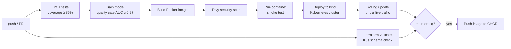

# mlops-delivery-pipeline

[](https://github.com/QuintonMcReynolds/mlops-delivery-pipeline/actions/workflows/ci.yml)

A machine-learning model taken all the way from training to a production-style deployment, with every step automated and checked on each push.

The model itself is deliberately simple (logistic regression on scikit-learn's built-in breast-cancer dataset, no downloads). The point of the repo is everything around it: testing, packaging, security, deployment, infrastructure as code and monitoring.

## What happens on every push



| Stage | What it proves | Where |
|---|---|---|
| Lint + tests | Code style, common bugs, 17 unit/API tests, coverage floor | `tests/`, `pyproject.toml` |
| Quality gate | A model that scores below AUC 0.97 / accuracy 0.93 cannot ship. The gate also runs inside the Docker build. | `model/train.py` |
| Infra checks | Terraform is formatted and valid; Kubernetes YAML matches the real API schema (kubeconform) | `terraform/`, `k8s/` |
| Security scan | No fixable HIGH/CRITICAL CVEs in the image (Trivy) | `ci.yml` |
| Smoke test | The real container answers health, version and prediction calls and rejects bad input | `scripts/smoke_test.sh` |
| Kubernetes deploy | The manifests actually run: probes pass, pods pass the `restricted` Pod Security level | `k8s/` |
| Rolling update | Config change rolls pods one by one while the API keeps answering | `ci.yml` |
| Publish | Image pushed to GitHub Container Registry, tagged with the commit SHA (and `latest` / version) | `ci.yml` |

## The service

FastAPI app in `app/main.py`:

| Endpoint | Purpose |
|---|---|
| `GET /healthz` | Liveness: the process is up |
| `GET /readyz` | Readiness: the model is loaded. Returns 503 if not, so traffic is held back instead of the pod crash-looping |
| `GET /version` | Model version, training time, data fingerprint, test metrics |
| `POST /predict` | Batch prediction; flags rows that are far outside the training data (simple drift signal) |
| `GET /metrics` | Prometheus metrics: request rate, latency histogram, predictions by label, out-of-distribution count |

Every response carries `x-request-id` and `x-model-version`; logs are one JSON object per line.

## Run it

```bash
make install        # virtualenv + dependencies
make test           # tests with coverage
make run            # http://localhost:8000/docs
make smoke          # in another terminal
```

With Docker:

```bash
make docker         # build and run the image
make compose        # API + Prometheus (:9090) + Grafana (:3000, dashboard pre-loaded)
```

## Production setup (described, not running)

- **Kubernetes** (`k8s/`, Kustomize): 2+ replicas, zero-downtime rolling updates (`maxUnavailable: 0`), startup/liveness/readiness probes, CPU autoscaling 2–6 pods, PodDisruptionBudget, non-root read-only container with all Linux capabilities dropped.
- **AWS** (`terraform/`): ECR (immutable tags, scan on push), ECS Fargate service behind an Application Load Balancer, automatic rollback via the deployment circuit breaker, CPU target-tracking autoscaling, CloudWatch logs. `deploy-aws.yml` runs plan/apply/destroy by hand through GitHub OIDC, so no AWS keys are stored in GitHub. It stays disabled until an AWS role is configured; nothing in this repo has been deployed to AWS.
- **Monitoring** (`monitoring/`): Prometheus alert rules for error rate > 5 %, p95 latency > 500 ms and input drift > 2 %, plus a Grafana dashboard.
- **Dependabot** keeps Python packages, GitHub Actions and the base image up to date.

## Layout

```
app/            FastAPI service
model/          training + quality gate
tests/          pytest suite
scripts/        smoke test used locally and in CI
k8s/            Kubernetes manifests (Kustomize)
terraform/      AWS ECS Fargate infrastructure
monitoring/     Prometheus config, alert rules, Grafana dashboard
.github/        CI/CD and manual AWS deploy workflows, Dependabot
docs/           LEARNING.md: a step-by-step guide to every piece
```

## Learning guide

[`docs/LEARNING.md`](docs/LEARNING.md) walks through each DevOps concept in this repo in order, with hands-on exercises.
